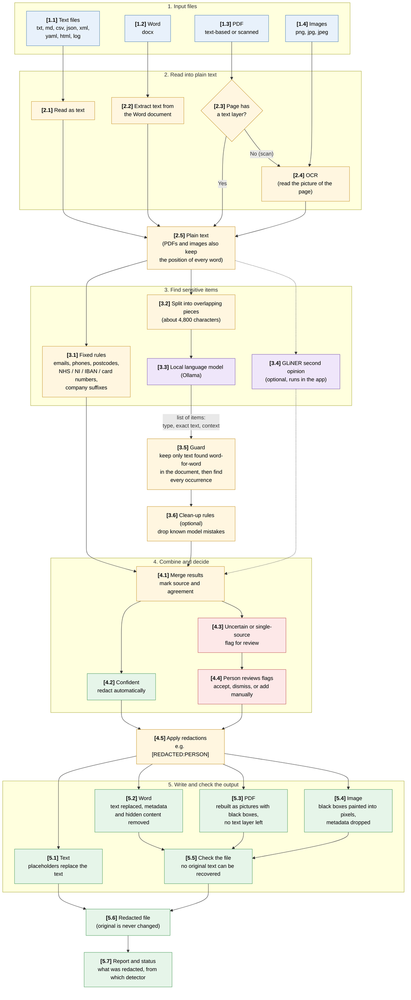
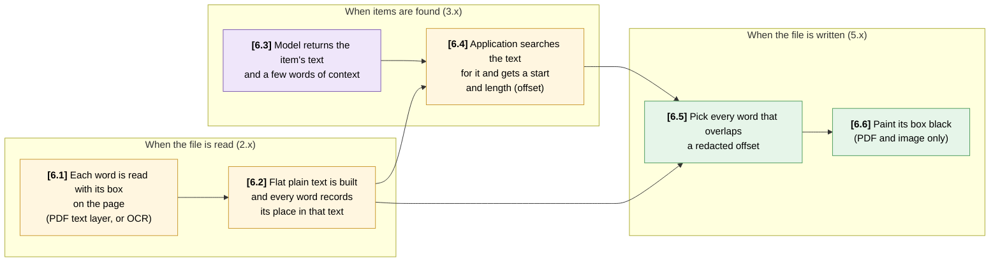

# Application flow

A high-level view of what happens to a document, from the file you give the tool to the redacted file and the reports it produces. For the reasons behind each step see [METHODOLOGY.md](METHODOLOGY.md).

Everything runs on the local machine. Document text is never sent outside it.

## The whole flow

## Step by step

| Step | What happens |
|---|---|
| **1. Input** | The tool accepts plain-text formats, Word (`.docx`), PDF, and images (`.png`, `.jpg`, `.jpeg`). Other file types are rejected as unsupported. |
| **2. Read** | Every file becomes plain text. Text files are read directly, Word text is extracted, and PDF pages with a text layer are read directly. Scanned PDF pages and images go through OCR. PDFs and images also remember where each word sits on the page, so it can be blacked out later. |
| **3. Find** | The text goes down two paths. The **fixed rules** find structured items instantly. The **language model** reads the text in overlapping pieces and returns a list of items (type, exact text, surrounding words). The **guard** keeps only items found word-for-word in the document and then finds every occurrence. **GLiNER** (off by default) gives a second opinion, and the **clean-up rules** (off by default) drop known model mistakes. |
| **4. Combine** | Results are merged and each item records which detector found it. Items that several detectors agree on are redacted automatically. Items found by one detector only, and places such as cities, are flagged for a person to accept or dismiss. The person can also add their own redactions. |
| **5. Write** | The redactions are applied and the file is written in its own format. Text files get `[REDACTED:TYPE]` placeholders. Word text is replaced and metadata and hidden content are removed. PDFs are rebuilt as pictures with black boxes, so no original text remains. Images get black boxes painted into the pixels, and their metadata is dropped. |
| **Check** | The output is checked before it is released: PDFs must contain no text at all, Word files are checked for the removed text, and scans are re-read with OCR to confirm nothing sensitive is still readable. |
| **Report** | A report and a status file are written to the report folder (by default `_report` inside the output folder), showing what was redacted and which detector found it. |

## What goes to the language model

| | |
|---|---|
| **Sent** | A prompt built from the enabled categories (what counts as sensitive, in plain English), the rules for answering, and one piece of the document text. |
| **Returned** | A JSON list. Each entry has a category, the exact text, and a few words of context. The model never says where in the document an item is. |
| **Then** | The tool finds each returned text in the document itself and discards anything it cannot find. The model's answers are only ever used to locate text, never to rewrite it. |

## Where files go

- **Input folder** (default `./in`): the originals, which are never modified or deleted.
- **Output folder** (default `./out`): redacted copies with a suffix (default `-redacted`), mirroring the input sub-folders.
- **Report folder** (default `<output>/_report`): the report and status files.

## Processes

Each box in the diagram, by reference number.

### 1. Input files

The file types the tool accepts. Anything else is rejected as unsupported.

- **1.1 Text files:** txt, md, csv, json, xml, yaml, html and log files, read as plain text.
- **1.2 Word:** `.docx` documents.
- **1.3 PDF:** either text-based, or scanned with no text layer. A single PDF can mix both kinds of page.
- **1.4 Images:** png, jpg and jpeg files, such as a photographed or scanned page.

### 2. Read into plain text

Every file is turned into plain text so the same detection steps work on all of them.

- **2.1 Read as text:** the file is read as it is. This is the simplest and most reliable path.
- **2.2 Extract Word text:** the text is pulled out of the Word document's internal XML.
- **2.3 Text layer check:** each PDF page is checked for text. A page with text is read directly, and one without goes to OCR.
- **2.4 OCR:** the page picture is read by optical character recognition. Quality depends on the scan, so this is where reading errors are most likely.
- **2.5 Plain text:** the result of every route. For PDFs and images it also keeps the position of each word, so it can be blacked out later.

### 3. Find sensitive items

Several independent detectors look at the text, each good at something different.

- **3.1 Fixed rules:** exact patterns such as emails, phone numbers, postcodes, NHS, National Insurance, IBAN and card numbers (with check digits), and company-name suffixes. Fast and repeatable.
- **3.2 Split into pieces:** long text is cut into overlapping pieces of about 4,800 characters, so an item on a boundary is not lost.
- **3.3 Language model:** a local Ollama model reads each piece and returns a list of items with type, exact text and context. It never says where an item is.
- **3.4 GLiNER:** an optional, fast second detector that runs inside the application. It is off by default and its finds are flagged for review, not redacted.
- **3.5 Guard:** keeps only items found word-for-word in the document, discards invented or altered text, and finds every occurrence, including shortened names.
- **3.6 Clean-up rules:** optional fixed checks, off by default, that drop known model mistakes such as template placeholders, masked values and generic terms like "Borrower".

### 4. Combine and decide

Results from all detectors are merged, and a person decides anything uncertain.

- **4.1 Merge:** results are combined, and each item records which detector found it and whether detectors agreed.
- **4.2 Confident:** items several detectors agree on are redacted automatically.
- **4.3 Flag for review:** items found by only one detector, and places such as cities, are held back for a person.
- **4.4 Person reviews:** the reviewer accepts or dismisses flags and can add their own redactions. This is the step that keeps uncertain items from being guessed at.
- **4.5 Apply redactions:** accepted items are replaced, by default with a placeholder such as `[REDACTED:PERSON]`, whose template is configurable.

### 5. Write and check the output

The redacted file is written in its own format and checked before it is released.

- **5.1 Text output:** placeholders replace the sensitive text in a new text file.
- **5.2 Word output:** the text is replaced, and metadata and hidden content are removed.
- **5.3 PDF output:** the PDF is rebuilt as page pictures with black boxes, so no original text remains in the file.
- **5.4 Image output:** black boxes are painted into the pixels and metadata such as EXIF is dropped.
- **5.5 Check the file:** PDFs must contain no text, Word files are checked for the removed text, and scans are re-read with OCR to confirm nothing sensitive is still readable. A file that fails is not released.
- **5.6 Redacted file:** written to the output folder with a suffix (default `-redacted`). The original is never changed.
- **5.7 Report and status:** records what was redacted and which detector found it, in the report folder.

## How positions are found

The language model never says *where* an item is, only what it is. The application works out the position itself, in two steps. The box references below are from the diagram above.

### Step 1: the position in the text (every file type)

- The model returns the item's exact text and a few words of context. The application searches the text for it. It uses the context to place an item at the right spot, and otherwise finds every occurrence, ignoring case and allowing different spacing or line breaks.
- The result is a **start and length** in the flat plain text. The fixed rules and GLiNER give start and length in the same form.
- Anything the model returns that cannot be found word-for-word is discarded, so an invented answer can never cause a redaction.

### Step 2: the position on the page (PDFs and images only)

- When the file is read, the application builds the flat text and a **word list** together. Each word records where it sits in the text and its box on the page (position, width and height).
- The boxes come from the PDF's text layer, or from OCR for scans and images. OCR boxes can also carry four corner points, so the box can follow a tilted scan.
- When the file is written, every word that overlaps a redacted start and length is picked. Whole words are covered, so no partial letters show. Each box is padded slightly and painted black.

Word and plain-text files skip step 2, because they are redacted by replacing the text itself.

### What this means in practice

- The page position is a lookup from text position to word box, so it is only as good as the word list. On a scan, if OCR misreads a word the box is still in the right place, but the detectors saw the wrong text. That is why scanned output is re-read with OCR to confirm nothing sensitive is still readable (5.5).
